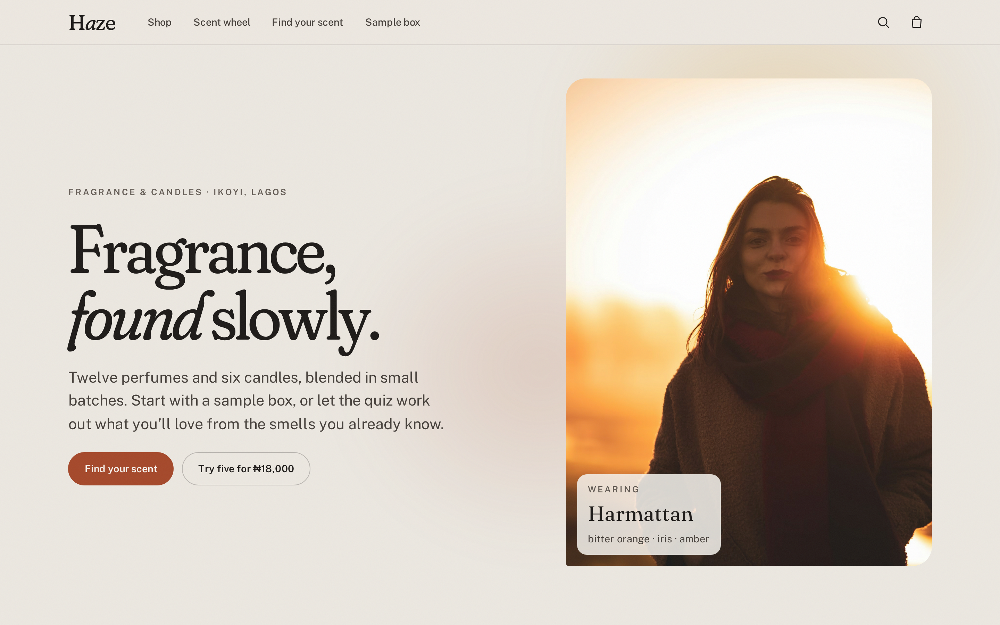
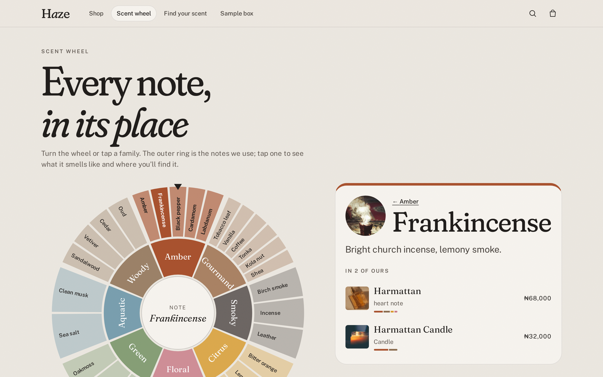
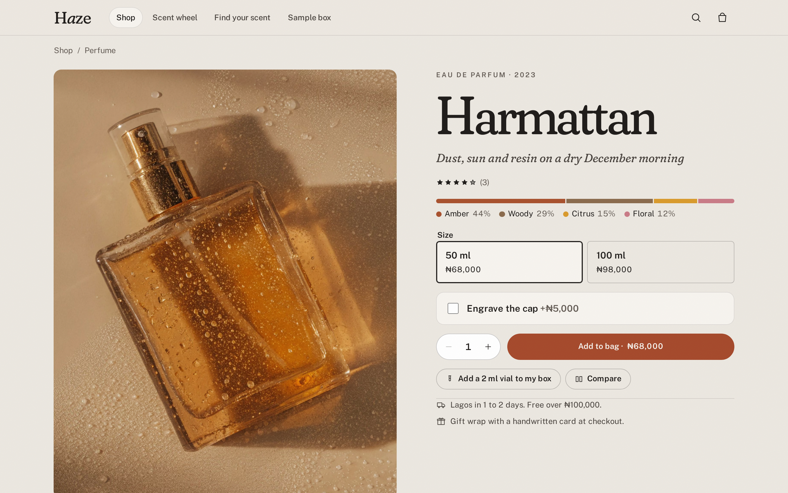
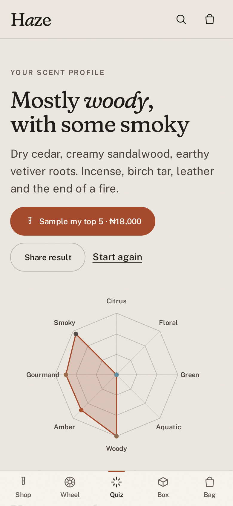
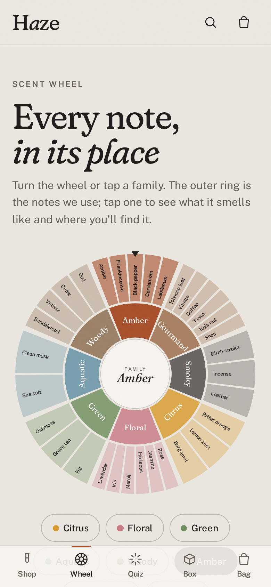
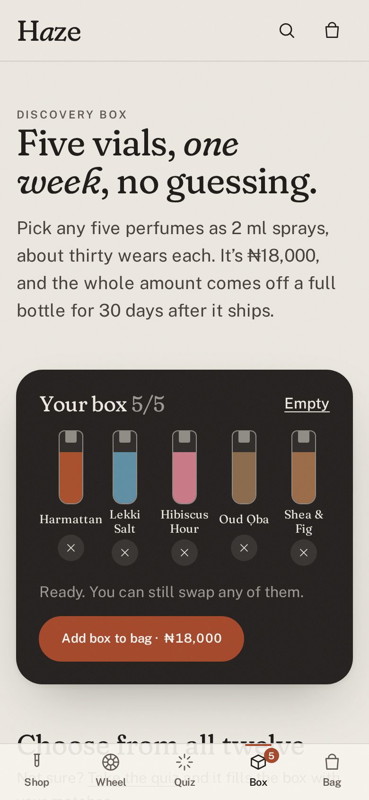

# Haze

**Fragrance, found slowly.** Haze is a shop for a small (made-up) Lagos fragrance and candle house, built around the hard part of buying perfume online: you can’t smell it. So instead of a grid and a buy button, it gives you ways in. Swipe through smells you already know and get matched with reasons. Spin a scent wheel to see what a note smells like and which perfumes carry it. Put three bottles side by side. Then try five as 2 ml vials, and get what you paid back as credit on a full bottle.

It’s a front-end project. The catalogue, pricing and payment gateway are mocks inside this repo, so it clones and runs with no keys and no backend. Haze, its perfumers and its prices are fictional; the photographs are real.

**Live:** https://haze-phi-seven.vercel.app

| Home (desktop) | Scent wheel (desktop) | Product with note pyramid (desktop) |
| --- | --- | --- |
|  |  |  |

| Quiz result (mobile) | Scent wheel (mobile) | Sample box (mobile) |
| --- | --- | --- |
|  |  |  |

## What you can do

- **Scent quiz.** Eight cards, from sea spray at dawn to the end of a fire. Drag a card right to keep it, left to pass (or use the buttons, or ← →). Three dials follow: fresh or cosy, how loud, day or night. The result is a radar of your profile and your top matches with a score and a plain reason for each (“Strong on woody and smoky, which you went for”). The answers are encoded in the URL, so a result can be shared, and one tap puts your top five in a sample box.
- **Scent wheel.** An SVG wheel of eight families and thirty-two notes. Tap a family or note, or drag to spin it; on release it settles on the family at the top. The side panel says what the note smells like and lists every product that uses it and where (top, heart, base). It’s fully keyboard operable and the selection lives in the URL, so product pages link straight to a note.
- **Product pages** show the family mix as a coloured “blotter strip”, a tappable note pyramid, and a dry-down slider: drag through the day and watch the top notes fade, the heart peak and the base take over. Engrave the cap with a live preview on a brass plate (validated: twelve plain characters). Sizes show live stock. “If you like this” is ranked by family shape and shared notes.
- **Compare** up to three perfumes in a table that highlights the notes they share, with strength, longevity, best time and price per ml. Add from any card; a floating tray follows you until you open it. The URL is shareable.
- **Sample box.** Pick five 2 ml vials (they fill with the colour of each perfume’s main family), reorder them, or let it fill the rest. The ₦18,000 comes back as credit on your next full-size bottle for thirty days, worked out from your order history.
- **Shop** by type, family and time of day, with sorting; filters live in the URL. **Search** from anywhere (⌘K or /) over names and notes.
- **Bag and checkout.** Quantity steppers capped at stock, inline undo, gift wrap with a handwritten card message. Checkout offers delivery by state (Lagos, nationwide, or collect from the studio), validates everything with errors linked to fields and focus on the first one, and pays by card or transfer. The order page shows what happens next and the credit you earned.
- **Phone first.** A bottom tab bar for the four tools and the bag, swipeable galleries, 44px+ targets, safe-area insets. Desktop gets a full nav and sticky panels.

### Test cards

| Card | Result |
| --- | --- |
| `4084 0840 8408 4081` | Approved |
| `4000 0000 0000 0002` | Declined |
| `5061 0000 0000 0000 007` (Verve) | Insufficient funds |

Any future expiry and any CVV. The payment form has one-tap buttons that fill these in. Nothing is charged.

### Installable

Haze is a PWA (vite-plugin-pwa + Workbox): manifest with maskable and Apple icons, shortcuts to the quiz and the sample box, the app shell and fonts precached, photos cached as you browse. Bag, box, compare list and orders are stored on the device, so they survive reloads and work offline. A new deploy shows an “Update” prompt rather than swapping code under you.

## Stack

- **Vite + React 19 + TypeScript** (strict), **React Router 7** with lazy-loaded routes and scroll restoration
- **Zustand** with `persist` for bag, sample box, compare and orders
- **Motion** for the swipe deck (drag, spring back, fling)
- **CSS Modules** on design tokens. No UI kit: Fraunces (with its soft, wonky italic) and Public Sans; a fog-and-smoke palette with one ember accent; a faint film grain so flat fills don’t look digital. Family colours are used as data, not decoration.
- **Vitest** for unit tests, **Playwright + axe-core** for end-to-end and accessibility at 390px and 1440px
- **GitHub Actions** CI, **Vercel** hosting

## How it is put together

```
src/
  pages/        home, shop, product (note pyramid, dry-down), wheel, quiz, compare, box, checkout, order, credits
  api/          the "server": search and checkout (re-price, check stock, cap credit, pretend to charge)
  lib/          pure logic with tests: quiz, profile, wheel geometry, dry-down, box, compare, cart, shop, payment
  stores/       zustand: cart, box, compare, orders, ui
  data/         perfumes, candles, notes and families, photo metadata and credits
  components/   AppShell, Photo, Dialog, BagDrawer, SearchPanel, ProductCard, ScentStrip, Radar, CompareTray…
scripts/        build-images (AVIF/WebP + blur placeholders), build-icons, screenshots
```

Some decisions:

- **The matching is explainable.** `matchFragrances()` scores each perfume as 70% cosine similarity between your family profile and its own, 20% closeness to the strength you asked for, 10% time of day, and records the reasons as it goes. Passing on a card subtracts from those families, so “no” is information too.
- **Geometry is plain functions.** Arc paths, segment subdivision, “shortest way round” rotation and label flipping for the wheel are in `lib/wheel.ts` with tests, so the component only wires up pointer and keyboard events.
- **Prices are never trusted from the client.** The bag stores slugs, size ids and quantities. `processCheckout()` re-prices from the catalogue, checks stock, refuses quantities the UI would never send, and caps the box credit at what your order history has earned.
- **Photos are prepared ahead of time.** `scripts/build-images.mjs` encodes each original to AVIF and WebP at several widths and records aspect ratio, dominant colour and a tiny blur placeholder. `<Photo>` renders a `<picture>` with those, so there is no layout shift and no image service.

### Accessibility

Native `<dialog>` for the bag and search, with focus returned to the trigger. The wheel’s segments are buttons with names and pressed state, operable with Tab and Enter, and mirrored by a row of family chips. The quiz can be done entirely with buttons or arrow keys; the sliders announce words, not numbers. Sizes, delivery and payment are real radio groups, and checkout errors are linked to their fields. Undo for a removed item is inline in the drawer, because a toast behind a modal can’t be reached. Every main screen is checked with axe on a phone and a desktop.

## Running it

Requires Node 22 (see `.nvmrc`).

```bash
npm install
npm run dev                      # http://localhost:5173
npm test                         # unit tests
npm run build && npm run e2e     # Playwright against the production build (port 4391)
npm run lint && npm run typecheck
```

`npm run images` regenerates `public/photos` from originals in `photos/originals` (not committed because of their size; `photos/photos.json` lists every source).

## Photo credits

All photographs are from [Unsplash](https://unsplash.com) and used under the [Unsplash License](https://unsplash.com/license). Every photographer is credited by name, with links, on the [/credits](src/pages/CreditsPage.tsx) page, built from `src/data/photo-credits.json`. The people and bottles pictured have no connection to the fictional brand.

## License

Code is MIT, see [LICENSE](LICENSE). Photos remain under the Unsplash License.
